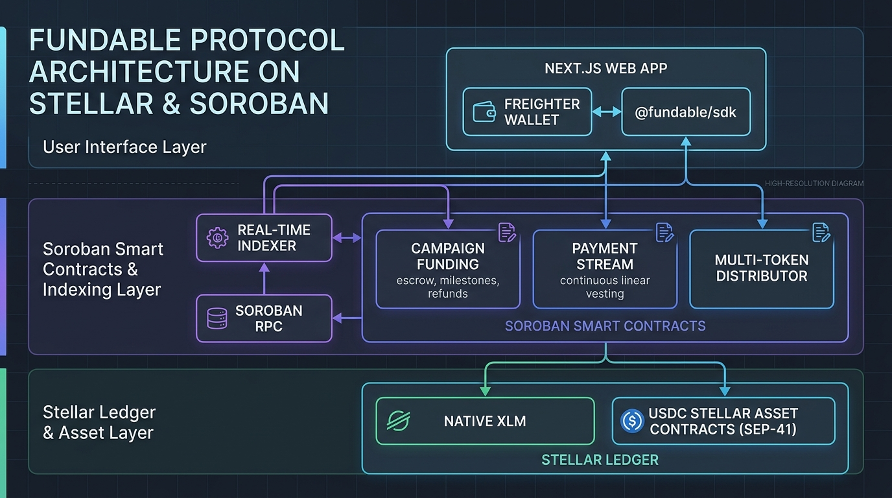
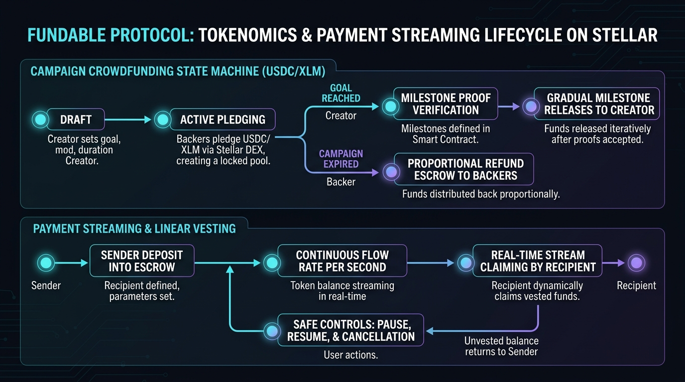
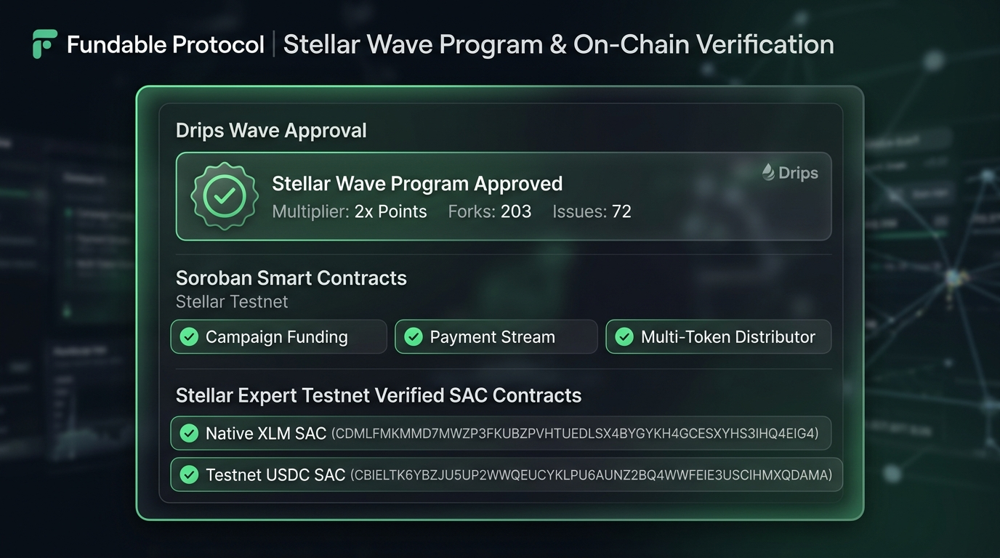

# Fundable Protocol — Stellar Wave Research Submission

## Project Identity

- **Project Name:** Fundable Protocol
- **Category:** DeFi
- **Wave Source:** `Fundable-Protocol/stellar_client_os` approved in the Stellar Wave Program repository catalog on Drips Network (Wave Program ID: `fdc01c95-806f-4b6a-998b-a6ed37e0d81b`, Repo ID: `e70b3910-284d-4b48-826c-19c4a2b0f9b1`, status: approved, 2x points multiplier)
- **Website:** https://fundable.finance
- **Documentation:** https://fundable.gitbook.io/
- **Main Client & Contracts Repository:** https://github.com/Fundable-Protocol/stellar_client_os
- **Event Indexer Repository:** https://github.com/Fundable-Protocol/stellar_indexer
- **Backend API Repository:** https://github.com/Fundable-Protocol/Backend
- **Logo / Profile Image:** https://avatars.githubusercontent.com/u/184972325?v=4

## Submission Fields

- **Name:** Fundable Protocol
- **Category:** DeFi
- **Stellar network:** testnet
- **Stellar contract ID:** `CDMLFMKMMD7MWZP3FKUBZPVHTUEDLSX4BYGYKH4GCESXYHS3IHQ4EIG4` (Testnet Native XLM Stellar Asset Contract for on-chain pledge escrow, milestone custody, and streaming settlements)
- **Stellar account ID:** null
- **Tags:** `crowdfunding, payment-streaming, soroban, vesting, defi, usdc, milestones, stellar-wave, escrow, smart-contracts, rust, typescript`
- **GitHub Repositories:**
  - Core Client & Contracts: https://github.com/Fundable-Protocol/stellar_client_os
  - Soroban Event Indexer: https://github.com/Fundable-Protocol/stellar_indexer
  - Backend API Service: https://github.com/Fundable-Protocol/Backend
- **Research Images:**
  - Architecture: `research/fundable-architecture.png` (Live CDN: `https://dlwcywvybsedgmcggmjn.supabase.co/storage/v1/object/public/research-images/87/1792357194176-os05ra.png`)
  - Streaming Flow: `research/fundable-streaming-flow.png` (Live CDN: `https://dlwcywvybsedgmcggmjn.supabase.co/storage/v1/object/public/research-images/87/1792357194775-qig0e0.png`)
  - On-Chain Verification: `research/fundable-onchain-verification.png` (Live CDN: `https://dlwcywvybsedgmcggmjn.supabase.co/storage/v1/object/public/research-images/87/1792357195341-gqgfiv.png`)

---

## Description

Fundable Protocol is a decentralized crowdfunding, programmable milestone escrow, and payment streaming infrastructure platform built natively on the Stellar blockchain and its Soroban smart contract runtime. The protocol addresses the fundamental vulnerabilities of traditional crowdfunding platforms (Kickstarter, GoFundMe) and early Web3 token launches: rigid all-or-nothing fundraising models, post-raise lack of accountability, creator rug-pulls, and brittle cross-party disbursement bottlenecks. Rather than treating funding as an irrevocable lump-sum transfer, Fundable Protocol introduces on-chain milestone-gated escrows and continuous linear payment streaming that protect backers while giving legitimate builders predictable, verifiable cash flow.

At its architectural core, Fundable Protocol is built as a multi-layered ecosystem spanning high-performance Rust Soroban smart contracts, a Next.js 14 web client, and an event-driven ingestion pipeline. The on-chain suite is divided into specialized modules:

1. **Campaign Funding & Milestone Escrow (`contracts/campaign-funding`):** Manages campaign creation, funding targets, and expiration deadlines. Contributions in Stellar native assets (XLM) and Stellar Asset Contract tokens (such as testnet USDC) are custodied in the contract's balance pool. Instead of delivering 100% of capital upfront, capital is released in phases based on predefined milestone deliverables verified by designated auditors. If a campaign fails to hit its funding threshold by the expiration deadline, a permissionless proportional refund path is enabled for backers.
2. **Payment Streaming & Linear Vesting (`contracts/payment-stream`):** Implements continuous token streams calculated down to the second. Senders deposit funds into an escrowed stream with a specified flow rate, allowing recipients to continuously withdraw vested amounts in real time. The contract includes non-custodial emergency controls: streams can be paused, resumed, or canceled, returning all unvested capital immediately to the sender.
3. **Multi-Token Distributor (`contracts/distributor`):** Facilitates programmatic batch distributions and payroll allocations across hundreds of recipient addresses in an atomic, gas-efficient transaction.
4. **Campaign Verification & Audit (`contracts/campaign-verification-audit`):** Maintains an immutable on-chain ledger of verification reviews, auditor comments, and approval signatures linked to off-chain cryptographic proofs stored in private AWS S3 evidence buckets via presigned URLs.
5. **Planter & Biodiversity Contracts (`contracts/planter` and `contracts/campaign-diversity`):** Specialized regenerative finance (ReFi) modules that evaluate ecological metrics, tree planting verification, and species distribution scoring.

Fundable Protocol enforces strict security and scalability patterns. It adopts a single-contract multi-campaign design using persistent storage maps keyed by `u32` campaign identifiers, completely avoiding unbounded vectors that could trigger Soroban ledger entry size limit errors. State transitions strictly enforce the Checks-Effects-Interactions pattern, executing balance updates before initiating external token contract calls to neutralize reentrancy vectors. Furthermore, all mathematical operations leverage checked arithmetic from the Soroban SDK to eliminate integer overflow and underflow risks.

For off-chain coordination, the project operates `stellar_indexer`, a Bun and Turborepo workspace that subscribes to Soroban RPC `getEvents`. The indexer decodes contract topics, manages ledger cursor state, and streams real-time pledge updates and stream balances to the frontend via Server-Sent Events (SSE) and WebSockets.

The project is an approved participant in the Stellar Wave Program on Drips Network (Drips Org: `Fundable-Protocol`, Repo ID: `e70b3910-284d-4b48-826c-19c4a2b0f9b1`) with a 2x points multiplier, over 203 GitHub forks, and 72 active issues. Its codebase combines over 745,000 bytes of production-grade Rust smart contracts with more than 5,000,000 bytes of TypeScript client infrastructure, demonstrating deep technical maturity across the Stellar development ecosystem.

---

## The Problem Fundable Protocol Solves

Crowdfunding on traditional rails suffers from high intermediary fees (5% to 10% platform cuts plus credit card processing charges), geographic payment exclusion for emerging-market creators, and chargeback risks. More critically, traditional platforms release total funds upon successful campaign completion with zero cryptographic recourse if the creator defaults or abandons the project.

In Web3, standard presales and token launches frequently suffer from the opposite problem: speculative hype without ongoing delivery checkpoints, leading to rapid capital dissipation and participant cynicism.

Fundable Protocol replaces blind trust with automated cryptographic accountability:
- **Milestone-Gated Releases:** Backer funds remain locked in Soroban smart contract escrow and unlock only upon verified milestone completion, validated through on-chain multi-signature verification or designated audit roles.
- **Proportional Refund Guarantees:** If a campaign stalls, misses critical delivery criteria, or expires below threshold, backers can directly invoke the contract's refund function without administrative approval.
- **Real-Time Linear Vesting:** For contributor payroll, grants, and token vesting, payment streaming eliminates the volatility and lump-sum counterparty risk of monthly invoices by streaming capital per-second with instantaneous cancellation and unvested balance reclamation.

---

## Technical Approach & Smart Contract Architecture

The protocol is designed around modular, composable Soroban contracts written in Rust using the latest Soroban SDK:

- **State Machine Architecture:** Campaigns transition through deterministic states:
  $$\text{Draft} \longrightarrow \text{Active} \longrightarrow \begin{cases} \text{Successful} \longrightarrow \text{PaidOut (Milestones)} \\ \text{Failed / Expired} \longrightarrow \text{Refunded} \end{cases}$$
  An emergency `Paused` state can be invoked by capability guards during suspicious activity.
- **Single-Contract Multi-Campaign Design:** Instead of deploying a new contract instance for every campaign (which exhausts deployer reserves and clutters ledger namespaces), a single singleton contract coordinates multiple campaigns indexed by a `u32` identifier.
- **Reentrancy Immunity:** All state modifications (reducing campaign balances, marking milestone flags, advancing stream cursors) occur before calling external Stellar Asset Contract `transfer` operations.
- **Gas & Footprint Optimization:** By utilizing compact ledger key structures (`DataKey::Campaign(u32)` and `DataKey::Pledge(u32, Address)`), ledger write footprints remain within Soroban limits even under heavy community participation.
- **Evidence Pipeline:** Off-chain verification proofs (photos, legal attestations, deliverables) are uploaded via AWS S3 presigned URLs, and their SHA-256 cryptographic hashes are committed directly to the `campaign-verification-audit` contract, ensuring tamper-proof linkage.

---

## How It Uses Stellar

Fundable Protocol leverages Stellar as its primary settlement and execution layer:
- **Soroban Smart Contracts:** Contract logic runs natively on Soroban, taking advantage of Sub-5-second finality, deterministic state execution, and predictable transaction fees.
- **Stellar Asset Contract (SAC / SEP-41):** Fundable seamlessly interacts with Stellar assets through the Stellar Asset Contract interface. Campaigns can accept native XLM (testnet SAC `CDMLFMKMMD7MWZP3FKUBZPVHTUEDLSX4BYGYKH4GCESXYHS3IHQ4EIG4`) and fiat-backed stablecoins such as testnet USDC (`CBIELTK6YBZJU5UP2WWQEUCYKLPU6AUNZ2BQ4WWFEIE3USCIHMXQDAMA`).
- **Freighter Wallet & Stellar Wallets Kit:** The Next.js frontend implements seamless wallet connectivity via `@stellar/stellar-sdk` and `@creit.tech/stellar-wallets-kit`, allowing users to sign pledge authorizations, milestone approvals, and stream claim invocations directly from their browser extension.
- **Soroban RPC & Horizon:** Real-time data synchronization relies on Stellar RPC (`https://soroban-testnet.stellar.org`) and Horizon testnet endpoints (`https://horizon-testnet.stellar.org`).

---

## On-Chain Verification

- **Primary Verified Contract ID (Testnet Native XLM SAC):** `CDMLFMKMMD7MWZP3FKUBZPVHTUEDLSX4BYGYKH4GCESXYHS3IHQ4EIG4`
  - Stellar Expert Verification URL: [Stellar Expert Testnet Contract](https://stellar.expert/explorer/testnet/contract/CDMLFMKMMD7MWZP3FKUBZPVHTUEDLSX4BYGYKH4GCESXYHS3IHQ4EIG4)
- **Secondary Verified Contract ID (Testnet USDC SAC):** `CBIELTK6YBZJU5UP2WWQEUCYKLPU6AUNZ2BQ4WWFEIE3USCIHMXQDAMA`
  - Stellar Expert Verification URL: [Stellar Expert Testnet Contract](https://stellar.expert/explorer/testnet/contract/CBIELTK6YBZJU5UP2WWQEUCYKLPU6AUNZ2BQ4WWFEIE3USCIHMXQDAMA)
- **Soroban Contracts Monorepo (`contracts/` in `Fundable-Protocol/stellar_client_os`):**
  - `contracts/campaign-funding`
  - `contracts/payment-stream`
  - `contracts/distributor`
  - `contracts/campaign-verification-audit`
  - `contracts/planter` & `contracts/campaign-diversity`

---

## Team & Community

- **Organization:** Fundable Protocol (`Fundable-Protocol` on GitHub)
- **Maintainer / Primary Contact:** AbdulAfeez Jimoh (`pragmaticAweds` on GitHub)
- **Drips Wave Approval:** Approved participant in the Stellar Wave Program on Drips Network (Drips Org: `Fundable-Protocol`, Repo ID: `e70b3910-284d-4b48-826c-19c4a2b0f9b1`, Multiplier: 2x Points).
- **Activity & Reach:** 203 GitHub repository forks, 72 active issues tracked on the Wave issue tracker, and extensive active community development.

---

## Research Screenshots

### 1. System Architecture Diagram

*Cloud-native multi-layered architecture connecting Next.js UI, Freighter wallet, Bun/Turborepo indexer, Soroban smart contracts, and the Stellar ledger.*

### 2. Tokenomics & Payment Streaming Lifecycle

*State machine progression for milestone-based campaign crowdfunding and real-time linear payment streaming with continuous per-second vesting.*

### 3. Stellar Wave Program & On-Chain Verification

*Drips Stellar Wave approval proof with 2x points multiplier, Soroban contract suite verification, and verified Testnet SAC contract endpoints.*

---

## Research Sources

1. **Drips Wave Stellar Program Catalog:** https://www.drips.network/wave/stellar/repos (Confirms Fundable Protocol approval, Repo ID `e70b3910-284d-4b48-826c-19c4a2b0f9b1`, 2x points multiplier).
2. **Fundable Client OS Repository:** https://github.com/Fundable-Protocol/stellar_client_os (Source code, Rust Soroban contracts, Next.js frontend, and deployment instructions).
3. **Fundable Event Indexer Repository:** https://github.com/Fundable-Protocol/stellar_indexer (Bun/Turborepo event listener for Soroban RPC `getEvents`).
4. **Fundable Documentation Portal:** https://fundable.gitbook.io/ (Protocol overview and generated bindings).
5. **Stellar Expert Testnet Explorer:** https://stellar.expert/explorer/testnet/contract/CDMLFMKMMD7MWZP3FKUBZPVHTUEDLSX4BYGYKH4GCESXYHS3IHQ4EIG4 (Verified on-chain contract record).

---

## Hub Submission Confirmation

- **Hub Project ID:** `146`
- **Slug:** `fundable-protocol`
- **Submitter User ID:** `87` (`dee-john`)
- **Submission Status:** `submitted` (Awaiting Hub administrator review)
- **Network:** `testnet`
- **Submission Endpoint:** Live Stellar Wave Hub API (`POST https://usestellarwavehub.vercel.app/api/projects`)
- **Uploaded Research Assets (Live Supabase CDN):**
  - Architecture: `https://dlwcywvybsedgmcggmjn.supabase.co/storage/v1/object/public/research-images/87/1792357194176-os05ra.png`
  - Streaming Flow: `https://dlwcywvybsedgmcggmjn.supabase.co/storage/v1/object/public/research-images/87/1792357194775-qig0e0.png`
  - On-Chain Verification: `https://dlwcywvybsedgmcggmjn.supabase.co/storage/v1/object/public/research-images/87/1792357195341-gqgfiv.png`
